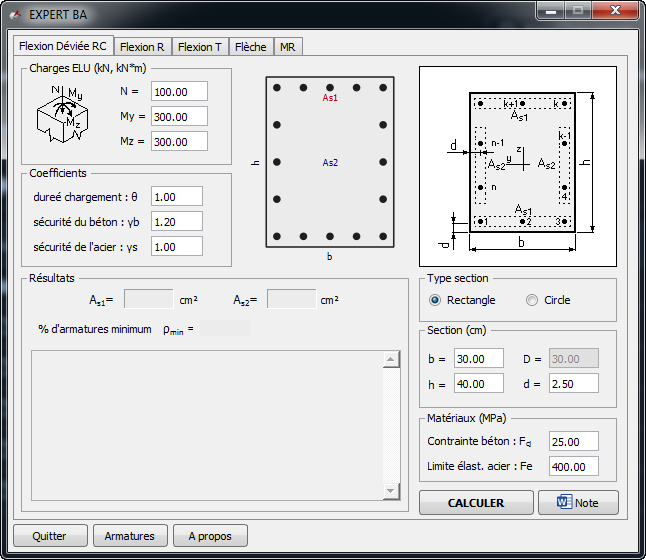

# EXPERT_BA

EXPERT_BA – BAEL 91 mod. 99

Application de calcul et de vérification des sections en béton armé selon le règlement BAEL 91 modifié 99.

**Version 2.0.0**

## Fonctionnalités principales

- Flexion simple et composée (section rectangulaire).
- Flexion simple (section en T).
- Flexion déviée composée (sections rectangulaires et circulaires).
- Calcul du moment résistant Mrd.
- Diagramme d'interaction N-M.
- Calcul de la flèche des poutres (rectangle et T).
- Génération automatique des notes de calcul Word.

Un outil complémentaire « Armatures » permet le calcul des sections d'acier HA.

## Technologies

Python 3.8 · PyQt5 · Windows

## Téléchargement

Application disponible au format exécutable Windows (.exe).

Voir la section [Releases](https://github.com/hammoumorsli/EXPERT_BA/releases).

Développé par : **Morsli Hammou**

## 🖥️ Captures d'écran
### Flexion composée déviée – Sections rectangulaire et circulaire

### Flexion simple et composée – Section rectangulaire (R)

### Flexion simple – Section en T

### Calcul de la flèche

### Calcul du moment résistant (MRd)

